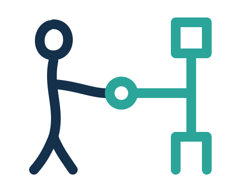

  

# Reasoning-First Methodology (RFM)

**Every complex project fails the same way: the thinking disappears.** Imagine you work on a project for a long period of time. Or a project whose complexity increases over time. When you go back to something you have not worked on for a while, you realize that you don't recall all the details anymore. Why did you start the project the way you did it? What motivated you in the first place? What choices did you reject and why? What were you assuming at the time? All you have in front of you is what you created. And if you are lucky, some notes, photos, documents, slides maybe. So next time you revisit your project you will have to guess or try to reconstruct.

If you have ever joined a project and had no idea why anything was built the way it was or if you have ever watched a team reconstruct a decision from scratch because nobody wrote down why they made it to begin with, this may be for you.

## What RFM does

Before any work is created, you think it through. For this, RFM works with an LLM as a partner. Jointly you start by writing down the why, your intentions, in a reasoning document. The actual result of your project - a slide deck or plan or software code - is created later.

This reasoning document has sections - like assumptions and what would break them, boundaries, but also open questions. It is essential that this document is honest. It does not defend, but describes what you think, so anyone can challenge it. It is a "living" document as it changes when conditions change or assumptions break. The reasoning documents retain the same section structure at every level, from the whole project down to each of its parts. You can compare it with a country map and a street map. They differ in resolution but they follow the same navigational rules and they still connect to each other.

## An example: a home battery

Here is a small example I can quickly explain where I used RFM together with Claude: should I buy a home battery to capture unused solar panel energy? Working through the reasoning I noted the assumption that the charging pattern of my car was predictable enough to properly size the battery. This would break if our commutes or our cars changed. And then it broke when we decided to replace our fossil fuel car with a second electric one. One car would often be plugged in to receive the extra solar power instead of a battery. There was no need to start all over because I had the thinking ready. Together with the arguments that home batteries have limited efficiency and are still quite costly, I decided not to buy and the thinking ended in building nothing.

## Why now, and why with an LLM

What used to take weeks to create can now be done in minutes via LLMs. But you lose the thinking time you used to have in your project. That loss becomes apparent when the LLM produces the result and lacks the bigger picture. Both you and the LLM need to know what you want to build and why you want to build it in one way and not another. Imagine the result becoming reproducible and replaceable. RFM attempts to do this by (re)creating your result from the documents. Then what needs time investment is the reasoning at the beginning.

Because of how LLMs are trained today, they are faced with a pull to agree and produce. Yet, RFM asks the LLM to be a partner and push back on weak reasoning. At the same time you have your own pull: you are tempted to accept what reads well and move on when you would need to understand and challenge the thinking. RFM provides a guide for your side too ([`RFM_human_guide.md`](https://github.com/hgoehlma/RFM/blob/main/RFM_human_guide.md)).

Creating the result of the thinking is the role of a second LLM. The LLM you discuss and think with could fill document gaps based on what you talked about if it were to also produce the result. Therefore it hands the second LLM only your documents. This second LLM carries out the work and notes where it had to guess. Then the result is jointly discussed with the LLM you think with and your documents are adjusted. Only then is the result adjusted or created again.

## Background

Looking at recent developments people start to understand the importance of retaining the why because an LLM can only invent it. Several approaches have been developed whereby the LLM questions you to understand what you are working on. Some start out by writing the specs first and others record the decisions they have taken. The components are there, but they are not together ([`RFM_top_level_reasoning.md`](https://github.com/hgoehlma/RFM/blob/main/RFM_top_level_reasoning.md) shows how RFM brings them together). RFM works with reasoning documents that bring the different sections together and are continuously updated, and they are the sources from which the results are derived. Furthermore, RFM aims to establish a partnership where you and the LLM both contribute and push back during the creation and curation of the source documents.

The main influence for me behind this work has been Simon Wardley's approach to mapping. He highlighted that by making your assumptions visible you can redirect any conversation from talking about people to talking about content. That is why RFM captures assumptions. RFM goes one step further and also captures what would break them. Another major influence for me was a course in biostatistics 25 years ago where it was highlighted that the best scientists spend most of their time in preparing an experiment rather than running it or analyzing it. Once you know what you want to do, how you do it and how you will analyze the data, the rest is only execution. When I saw and understood the need of LLMs to have the context, both insights made perfect sense to me: the reasoning has to come first.

Peter Naur highlighted in 1985 that a program's theory only lives in the heads of the people who built it. When they leave the project, this knowledge will leave with them. He also believed that this theory cannot be fully written down. I think enough of the knowledge can be written down so that work can be created from it. The notes of the second LLM show where it was not sufficient.

## Who it's for, and who it isn't

Do you want to build faster with ever more agents and ever-increasing agent autonomy? Likely RFM is not for you, because with RFM reasoning comes first. Even the second LLM that creates the result decides nothing without saying so: where your documents leave a gap, it notes its guess. Beyond that, RFM is a vehicle, not a prescription. What you create on top of it is yours.

And in case you wonder: the acronym for the methodology was chosen deliberately. Anyone who recognizes the older expansion already knows what this methodology thinks you should do before touching anything.

## Where to start

Most of what you need to do is copy a number of files and folders (instructions for the LLM and a few configuration files). Personally, I am using RFM together with both Claude Code (Sonnet 5 or higher) and OpenAI's Codex (GPT models 5.5 or higher). Either of them works. The environment for RFM needs to run on your local computer and not in the cloud. Have a look at [`RFM_setup_guide.md`](https://github.com/hgoehlma/RFM/blob/main/RFM_setup_guide.md). If you want to learn more, have a look at [`RFM_glossary.md`](https://github.com/hgoehlma/RFM/blob/main/RFM_glossary.md) for the glossary and [`RFM_map.md`](https://github.com/hgoehlma/RFM/blob/main/RFM_map.md) for the list of all documents in the project.

The approach is in active development. Every document is living, versioned and continuously curated.

---

## License

This work is licensed under a [Creative Commons Attribution-ShareAlike 4.0 International License](https://creativecommons.org/licenses/by-sa/4.0/).

© 2026 Hinrich W.H. Göhlmann

*Developed in collaboration with Claude (Anthropic), acting as partner throughout.*
